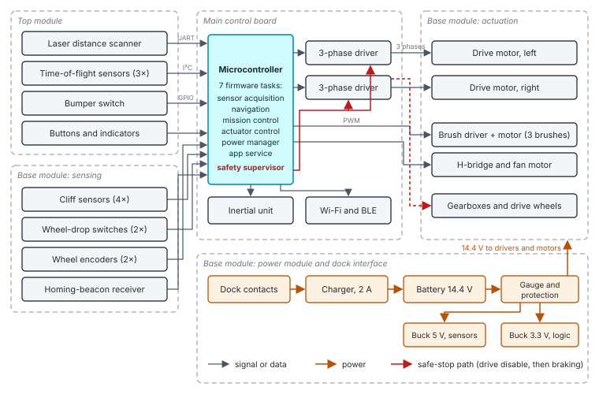
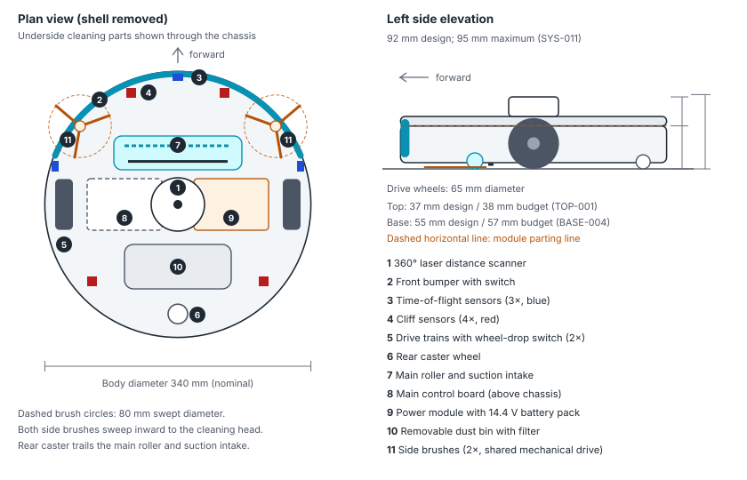

<!--
SPDX-FileCopyrightText: 2026 Elan8
SPDX-License-Identifier: MIT
-->

# Autonomous Floor Cleaning Robot (SysML v2)

[](LICENSE)
[](https://www.omg.org/spec/SysML/)
[](https://github.com/elan8/spec42)


A worked SysML v2 example of a cyber-physical product: an autonomous vacuum
cleaner, developed by Elan8 as the engineering company, from what the household
wants down to module budgets, a bill of materials and the verification plan.
The model is organized with the **Elan8 Method** folder layout, is validated
with [Spec42](https://github.com/elan8/spec42), and is the source of the
engineering evidence and authored document definitions.

Use it to see what a SysML v2 model of a real product looks like when it has to
carry the engineering, not only describe it:

| Question a project has to answer | Where the model answers it |
| --- | --- |
| What does the customer need? | 11 customer requirements in the household's words (`USR-…`) |
| What must the system do, measurably? | 21 system requirements, each a constraint against a design limit (`SYS-…`) |
| Is every need covered, and why? | One derivation per customer requirement, with the reason the set is complete |
| Who has to deliver what? | 13 module requirements with budgets for safe-stop time, mass, height and energy (`BASE-…`, `PCB-…`, `FW-…`, `TOP-…`) |
| What is it made of, and what does it cost and weigh? | Physical architecture with 49 parts; generated bill of materials and mass budget |
| Does the design hold? | Four analyses: mission energy, safe-stop timing, localization, mass |
| How will we know? | Twelve verification cases and five validation cases with methods and pass criteria; verification and validation matrices |





## What the showcase demonstrates

- Updated MBSE methodology areas: project context and stakeholder needs,
  shared library, flat systems, and document sources.
- Independent specification, architecture and integration roles from
  `Elan8::SystemsEngineering`; architectures type developed children by their contracts,
  and integrations select compatible child designs through redefinition.
- Ordinary leaf parts use native domain types; product-specific values, ports and
  catalog choices live with their owning systems. No component-profile adapters.
- Role definitions live directly in each system package, without nested
  Specification/Architecture/Integration packages. Useful requirement, evidence
  and view groupings remain.
- Elan8 requirement roles, native SysML requirement identifiers, and folder conventions
  without exposing methodology jargon as product-domain behavior.
- Definition/usage separation and one concrete `robotSystem` usage.
- Typed items, ports, connections, flows and allocations instead of internal
  identity encoded as strings.
- Explicit dock charging, protected battery distribution, homing-beacon reception,
  module wiring harnesses, and mechanical mounting relationships.
- Readable requirement names with stable identifiers, for example
  `requirement <'SYS-SAFE-011'> 'Safe stop on hazard'`.
- Requirements derived level by level: customer to system to module, each
  derivation recording why the derived set is complete or how the budget closes.
- Requirements satisfied by concrete behavior usages or parts and verified by
  twelve verification cases, each with an identifier, a method and a pass
  criterion, plus four quantitative analyses.
- Five validation cases that tie every customer requirement to evidence from
  use in a home.
- Trace tables, verification matrices and limit values that the documents read
  from the model, and a bill of materials and mass budget generated from it,
  with a build that fails on a gap.
- A reusable `PurchasedParts` library; named dependencies select catalog
  implementations without turning procurement choice into type specialization.
- Nine focused views and four methodology role views over the same graph.

The scope deliberately excludes product variants, trade studies, and
implementation handoff tables. Human-facing external identifiers such as
manufacturer part numbers stay text; internal model identity is semantic.

## Model map

| Path | Purpose |
| --- | --- |
| `00_context/Context.sysml` | Household context, external participants and context view |
| `10_usecases/UseCases.sysml` | Four operational scenarios |
| `20_requirements/StakeholderRequirements.sysml` | Eleven customer requirements |
| `50_library/` | Shared interfaces, firmware types, purchased parts and compatibility navigation |
| `60_systems/<System>/system.sysml` | Fourteen flat systems with their specifications, architectures, integrations and relevant evidence/views |
| `60_systems/VacuumCleanerSystem/Behavior.sysml` | Supporting behavior packages, publicly imported by the system |
| `80_documents/` | Generic document definitions, prose, figures and retained template |
| `Root.sysml` | Navigation; the workspace loads all model files |
| `../generated/` | Ignored BOM, mass budget, validation reports and diagrams |
| `../project.md` | Dependency baseline and model ownership conventions |

See [MODEL_GUIDE.md](docs/MODEL_GUIDE.md), [ELAN8_METHOD_TOUR.md](docs/ELAN8_METHOD_TOUR.md),
and [the purpose and scope of each view](docs/VIEWS.md).

## Engineering documents

Four engineering documents are defined in
[`model/80_documents/Documents.sysml`](model/80_documents/Documents.sysml),
using the generic `Elan8::Documents` vocabulary:

| Document | Number | Answers | Content |
| --- | --- | --- | --- |
| Customer Requirements Specification | RVC-CRS-001 | What does the household need? | Stakeholders, the reference home, scenarios, the 11 customer requirements, constraints |
| System Requirements Specification | RVC-SRS-001 | What shall the robot do, and how well? | System context, the 21 system requirements by kind, traceability to customer requirements. No design. |
| System Design Specification | RVC-SDS-001 | How is the robot built to do it? | Architecture, allocation of requirements to modules with budgets, firmware, bill of materials, analyses, requirement satisfaction |
| Verification and Validation Plan | RVC-VVP-001 | How will we know that it does? | Methods, test articles and facilities, 12 verification cases with pass criteria, the requirements verification matrix, 5 validation cases and the validation matrix |

**PDF generation is disabled** until a suitable Doc42 release and working
license are available. CI does not install or run Doc42, check document
rendering, build PDFs or upload engineering-document artifacts.

The authored document views, prose, figures and house template remain as
sources for a future renderer. These definitions are included in ordinary
SysML validation; that does not constitute a rendered-document check.

The BOM and mass-budget script remains available independently of Doc42. It
exports the physical model with Spec42, generates Markdown/CSV data, and checks
classification, mass, derivation, satisfaction, verification and validation gaps.
CI runs it as a model check:

```sh
python scripts/generate-document-data.py
python scripts/generate-document-data.py --check  # optional local freshness check
```

Its outputs go into ignored `generated/`, which is absent from a clean checkout.
No PDFs are generated. Authored sources remain tracked under `model/80_documents/`.

## Validation

Requires [Spec42](https://github.com/elan8/spec42) **0.56.0**, Python 3.9+,
and the exact domain-library and methodology commits in
[`dependencies.lock.json`](dependencies.lock.json). Put dependency checkouts
beside this repository or under `.libraries/`.

```powershell
./scripts/validate.ps1 -Spec42Exe <path-to-spec42>
python scripts/generate-document-data.py
./scripts/render-views.ps1 -Spec42Exe <path-to-rendering-build>
```

Validation checks language semantics, methodology definition structure and
complete child selection. All errors and unexpected warnings fail. Four known
Spec42 custom-view warnings are documented in [VALIDATION.md](docs/VALIDATION.md),
along with the structural checker's coverage limits. Diagram export requires the
separately pinned rendering source revision in the lock file for inherited views
and Boolean filters. PDF generation stays disabled.

## Status and limitations

This is an MBSE teaching and tool-validation model, not a certified product
design. Masses, timings and costs are engineering estimates chosen to be
plausible for this class of product; the bill of materials is not released for
production. Catalog metadata was checked against official
manufacturer sources, but lifecycle and availability must be reviewed again
before procurement.

Contributions are welcome; keep changes graph-first, run validation and update
the focused documentation when the public model interface changes.

## License

Licensed under the [MIT License](LICENSE). See [NOTICE.md](NOTICE.md).
