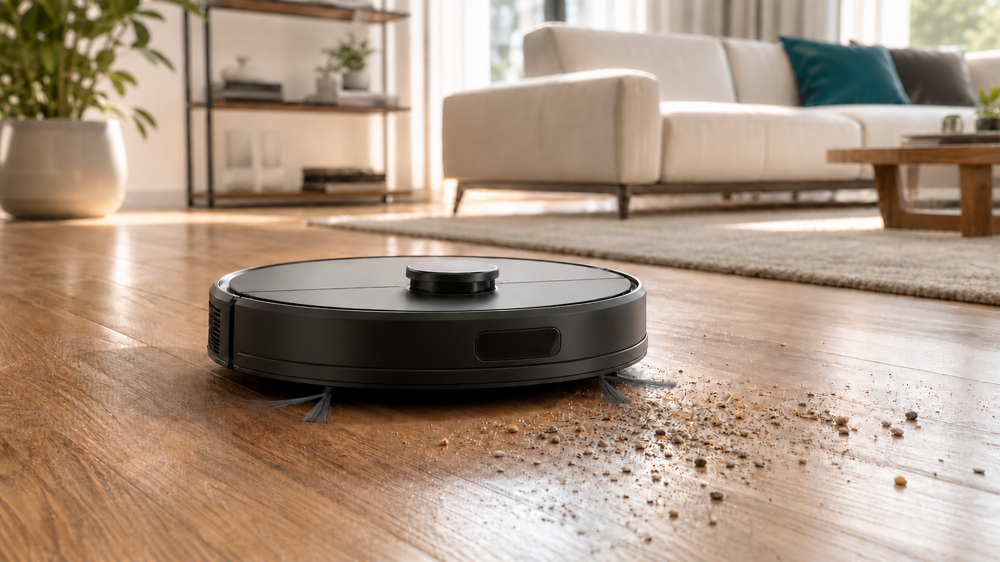

<!--
SPDX-FileCopyrightText: 2026 Elan8
SPDX-License-Identifier: MIT
-->

# Autonomous Floor Cleaning Robot (SysML v2)

[](LICENSE)
[](https://www.omg.org/spec/SysML/)
[](https://github.com/elan8/spec42)



A compact, graph-first SysML v2 showcase for an autonomous vacuum cleaner,
organized with the **Elan8 Method** folder layout. It uses one selected product
baseline, seven firmware tasks, six catalog parts and four representative
operational scenarios. Every view projects the same authoritative
requirements, behavior, architecture and verification elements.

## What the showcase demonstrates

- Elan8 Method model areas via folders `00_project` … `99_library`.
- Elan8 requirement roles, native SysML requirement identifiers, and folder conventions
  without exposing methodology jargon as product-domain behavior.
- Definition/usage separation and one concrete `robotSystem` usage.
- Typed items, ports, connections, flows and allocations instead of internal
  identity encoded as strings.
- Explicit dock charging, protected battery distribution, homing-beacon reception,
  module wiring harnesses, and mechanical mounting relationships.
- Requirements satisfied by concrete behavior usages and verified by nine
  verification cases plus three quantitative analyses.
- A reusable `PurchasedParts` library; named dependencies select catalog
  implementations without turning procurement choice into type specialization.
- Nine focused views over the same graph.

The scope deliberately excludes product variants, trade studies, and
implementation handoff tables. Human-facing external identifiers such as
manufacturer part numbers stay text; internal model identity is semantic.

## Model map

| Path | Purpose |
| --- | --- |
| `00_project/Project.sysml` | Project information |
| `05_requirements/` | Stakeholder needs, design limits, system requirements |
| `10_context/` | External actors and the residential operating boundary |
| `20_usecases/` | Four representative operational scenarios |
| `40_functions/` | Functional decomposition and operating states |
| `50_logical/` | Domain model and firmware architecture |
| `60_physical/` | Physical architecture and system-of-interest allocations |
| `70_analysis/` | Three quantitative analyses |
| `80_verification/` | Nine verification cases |
| `90_views/` | Nine focused views |
| `99_library/` | Purchased parts (units via `Elan8::Units::Engineering`) |
| `Root.sysml` | Workspace import hub |
| `../documents/` | Doc42 document definitions and prose, outside the model |

See [MODEL_GUIDE.md](docs/MODEL_GUIDE.md) and [ELAN8_METHOD_TOUR.md](docs/ELAN8_METHOD_TOUR.md).

## Engineering documents

Three documents are generated from the model with [Doc42](https://github.com/elan8/doc42-action),
with Elan8 as the engineering organization that issues them:

| Document | Number | Content |
| --- | --- | --- |
| Customer Requirements Specification | RVC-CRS-001 | Stakeholders, operating context, scenarios and the six customer requirements |
| System Requirements Specification | RVC-SRS-001 | System boundary, design limits, the twelve system requirements, traceability and verification approach |
| System Design Specification | RVC-SDS-001 | Functions, physical and firmware architecture, purchased components, analyses and requirement satisfaction |

They are defined in [`documents/Documents.sysml`](documents/Documents.sysml): each
document is a SysML view, its nested views are the sections, and its requirement
tables and diagrams are projected from the model. The surrounding text lives in
`documents/prose/`. Every push builds the PDFs; download them from the
`engineering-documents` artifact of the latest
[workflow run](../../actions/workflows/validate.yml).

```sh
doc42 check . --library-path <method-library> --library-path <domain-libraries>/model
doc42 build . --doc RobotDocuments::srs --out out --library-path ...
```

Checking the documents is free. Building them needs an Elan8 license in the
`ELAN8_LICENSE` environment variable; the model itself needs neither Doc42 nor a
license.

## Validation

Requires [Spec42](https://github.com/elan8/spec42) 0.54.1 or later and sibling
checkouts of `sysml-domain-libraries` and `mbse-methodology`:

```powershell
powershell -ExecutionPolicy Bypass -File .\scripts\validate.ps1
```

The release criterion is 0 errors, 0 warnings and 0 information diagnostics,
followed by successful SVG export of the views. See
[validation details](docs/VALIDATION.md).

## Status and limitations

This is an MBSE teaching and tool-validation model, not a certified product
design or production BOM. Catalog metadata was checked against official
manufacturer sources, but lifecycle and availability must be reviewed again
before procurement.

Contributions are welcome; keep changes graph-first, run validation and update
the focused documentation when the public model interface changes.

## License

Licensed under the [MIT License](LICENSE). See [NOTICE.md](NOTICE.md).
