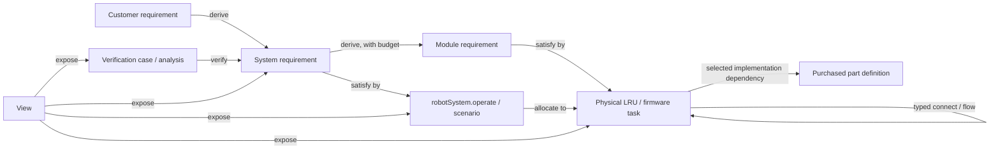

<!--
SPDX-FileCopyrightText: 2026 Elan8
SPDX-License-Identifier: MIT
-->

# Model guide

The model is intentionally small enough to read end to end. File paths follow
the Elan8 Method layout; SysML packages remain the semantic ownership boundary.

Start with the [Elan8 Method tour](ELAN8_METHOD_TOUR.md) to see how the method
organizes a model while the SysML elements retain product-domain names.

## Recommended tour

1. Start in `05_requirements/`. `CustomerRequirements.sysml` holds eleven needs in
   the household's words. `SystemRequirements.sysml` holds twenty-one testable
   requirements with quantities, constraints and Elan8 requirement roles.
   `ModuleRequirements.sysml` splits five of them into budgets for the modules.
   `RequirementTraceability.sysml` and `RequirementAllocation.sysml` hold the
   derivations between the levels, each with the reason the derived set is
   complete or the budget closes.
2. Read `40_functions/Functions.sysml`: `OperateCleaningRobot` decomposes
   product behavior. Compare the autonomous-cleaning, obstacle-avoidance,
   low-battery-return, and cliff-safe-stop scenarios in
   `20_usecases/UseCases.sysml`.
3. Open `60_physical/PhysicalArchitecture.sysml`: the selected baseline
   contains the major LRUs, typed interfaces, power rails, and catalog selections.
4. Follow `Architecture::robotSystem`. Its `operate` behavior usage is used for
   allocation and requirement satisfaction.
5. Inspect `50_logical/FirmwareArchitecture.sysml`: seven periodic or
   event-driven tasks, typed queues, scheduling priorities, and deadlines.
6. Continue into `70_analysis/Analysis.sysml` (`SafetyReactionAnalysis`) and
   `80_verification/Verification.sysml` (`'Cliff safe stop'`, VER-009), and the
   validation cases for the customer requirements in `Validation.sysml`.
7. Finish with the nine focused views in `90_views/ModelViews.sysml`.

## Semantic backbone



## Package ownership

| Package | Owns |
| --- | --- |
| `Project` | Tailoring and method profile |
| `Elan8::Units::Engineering` | Shared Ah/mAh/ms unit literals |
| `Elan8::Procurement` | `BuyPart` metadata and `PartLifecycleStatus` |
| `PurchasedParts` | Concrete catalog part selections annotated with `Elan8::Procurement::BuyPart` |
| `DomainModel` | Protocol vocabulary, items, ports, buses |
| `RequirementLimits`, `StakeholderNeeds`, `SystemRequirements` | Product intent and constraints |
| `ModuleBudgets`, `ModuleRequirements` | Budgets per module and the requirements that hold each module to its budget |
| `RequirementTraceability` | Derivations from customer requirements to system requirements |
| `RequirementAllocation` | Derivations from system requirements to module requirements |
| `Sourcing` | `BomItem` metadata: description, make or buy, unit cost |
| `FunctionalArchitecture`, `BehaviorStates`, `OperationalScenarios` | Capabilities, states, scenarios |
| `ProductContext` | Users, app, network, dock, home, robot boundary |
| `Elan8::Software` | `Task`, `PeriodicTask`, `EventDrivenTask`, `SoftwareQueue`, `ExecutionPlatform`, and their criticality/discipline/policy enums |
| `FirmwareArchitecture` | Vacuum-specific periodic and event-driven tasks plus typed runtime queues |
| `Elan8::Electronics::Actuation` | BLDC and brushed-DC motors, H-bridge and three-phase drivers, and mechanical outputs |
| `Elan8::Electronics::Sensing` | Powered/data sensors, I2C IMU, passive bumper/lift switches, and typed measurements |
| `Elan8::Electronics::Power` | `BatteryPack`, `BatteryCharger`, protected `BatteryManagementSystem` power paths, and `VoltageRegulator` |
| `Elan8::Electronics::{Board, Assembly}` | Bare `PrintedCircuitBoard` versus populated `PrintedCircuitBoardAssembly` |
| `Elan8::Mechanical::Core` | `MechanicalComponent` (`mass` only, purely mechanical parts — no ports, no `powerDraw`) |
| `Elan8::Mechanical::Drivetrain` | `Gearbox`, `Wheel`, `CasterWheel` |
| `PhysicalArchitecture` | Assembly-oriented baseline with an end-to-end dock/charger/BMS/battery path, explicit base and top wiring harnesses, separate safety GPIOs, mechanically connected drivetrains, a powered beacon receiver, debris transfer to the removable bin, and the local HMI integrated into `TopModule`. `MainPcbModule` is the populated PCB assembly. |
| `Architecture` | Concrete system, allocations, satisfaction |
| `RobotAnalysisCases` | Four analyses: mission energy, safety reaction, localization, mass budget |
| `Verification` | Twelve verification cases with identifier, method and pass criterion |
| `Validation` | Five validation cases for the customer requirements |
| `ModelViews` | Nine focused stakeholder views; see [VIEWS.md](VIEWS.md) |

## One source for every number

A limit is written once, as an attribute in `RequirementLimits` or `ModuleBudgets`. The
requirement's constraint refers to the attribute, and the requirement's text shows it
with a placeholder that Doc42 replaces by the value when it builds a document:

```sysml
requirement <'SYS-015'> 'Robot mass' {
  require constraint { robot.robotMass <= maxRobotMass }
  doc /* The robot shall have a mass of at most {{= RequirementLimits::maxRobotMass}} with an empty dust bin. */
}
```

The analyses and budgets use the same attributes, so changing a limit changes the
constraint, the analysis and the text of the requirement together. One number is still
typed in its requirement text, the cleaning area, because Spec42 does not evaluate a unit
written as an expression (`[m^2]`) yet.

## Bill of materials

Every physical part that is bought or made carries `@BomItem`, on its definition
when the part is used more than once and on its usage otherwise. Assemblies carry
none: they are the indented levels of the bill of materials. Mass is the ordinary
`mass` attribute that the mass roll-up uses, so the bill of materials and the mass
budget cannot disagree. `scripts/generate-document-data.py` walks the part tree of
`AutonomousFloorCleaningRobot` and fails for a part it cannot classify.

## Purchased parts

`BuyPart` is metadata for `SysML::PartDefinition`. Project definitions specialize
domain kinds; a named `dependency selectedImplementation` points at catalog parts.

## Deliberate boundaries

This baseline omits product-line engineering, trade studies, and handoff record
tables. It **does** use Elan8 Method libraries for requirement roles and concerns.
Engineering increments organize the work and its review; the resulting SysML model
uses domain-oriented names. Narrative guidance beyond semantics belongs in `doc`
and markdown tours.
